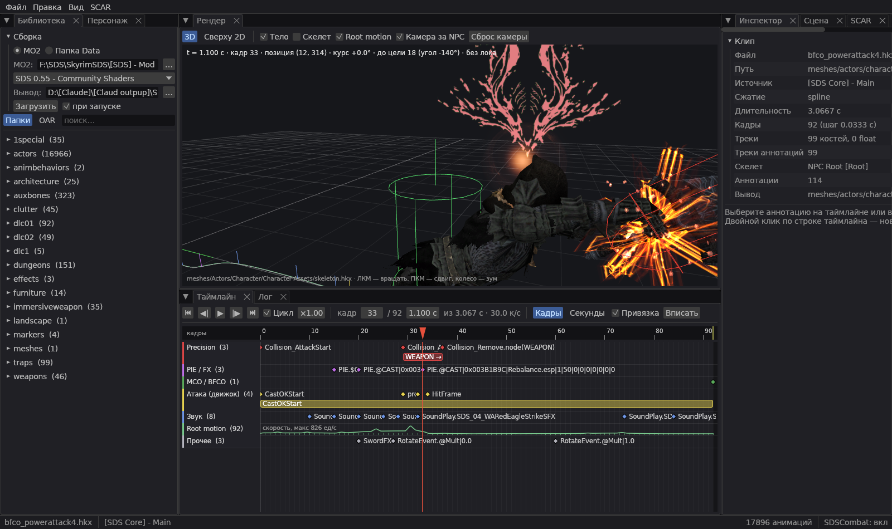

# SDS Anim Studio

An animation and annotation studio for **Skyrim Special Edition**, in the spirit of DS Anim Studio, built for the SDS (Skyrim Dragon Souls) modlist.

It reads a Mod Organizer 2 build (loose files and BSAs), plays HKX animations on NPCs dressed from their ESP records, and edits clip annotations with live previews:

- Precision hitboxes and trails;
- PIE spell art and particles, sounds (`SoundPlay`, effect sounds, weapon swings, footsteps);
- the NPC root-motion path with SDSCombat target lock / ReachTarget;
- SCAR action zones, a combo graph and a combo simulator;
- OAR submods, priorities and export.

Edited clips are written to a separate output mod folder; the source mods are never touched.



- **Full description:** [English](README_EN.md) · [Русский](README_RU.md)
- **Design notes (RU):** [ARCHITECTURE_RU.md](ARCHITECTURE_RU.md)
- **Interface languages:** Russian and English (RU | EN switch in the menu bar).

## Build

```
git clone <repository url>
cd <repository folder>
cargo build --release -p sds-anim-studio
```

- **Requirements:** Windows (rendering is wgpu; sound uses XAudio2 2.9 from Windows 10/11) and Rust stable.
- **Dependencies:** the Aether and serde-hkx crates the studio needs are vendored in [`vendor/`](vendor/README.md).
- **First start:** run `target\release\sds-anim-studio.exe`, then in the Library tab pick the MO2 folder and profile (or a plain Data folder) and press Load.

## License

GPL-3.0 — see [LICENSE](LICENSE).

- **serde-hkx** (vendored): MIT OR Apache-2.0; its own license files are kept in `vendor/serde-hkx`.
- **Bundled fonts:** DejaVu Sans (Bitstream Vera / DejaVu license) and Cascadia Mono (SIL Open Font License 1.1), with their licenses next to them in `crates/app/assets/fonts`.
